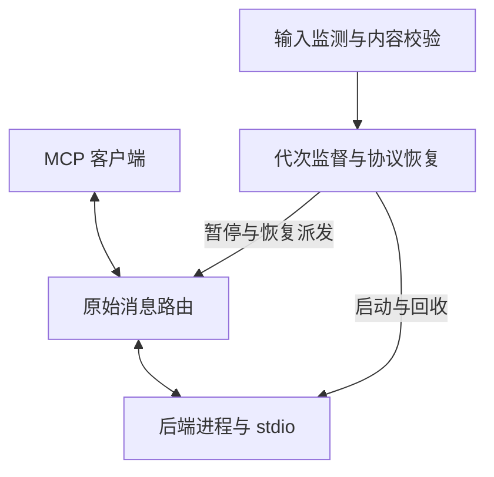
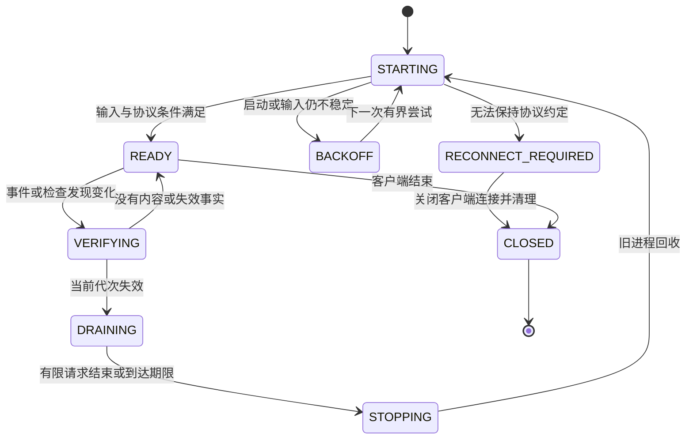

# 技术设计

状态：Implemented。本文保留目标设计；实际实现细节、验收证据与限制见 [实施记录](implementation-results.md)。本次尚未发布版本 tag。基线与阅读入口见 [README](README.md)。

## 1. 需求和不变量

客户端侧称为“前端连接”，gopls 子进程侧称为“后端连接”。generation 表示 proxy 发布的后端代次。每次 spawn 都分配永不复用的 backend_connection_id（亦作为 boot_id）；尚未发布的失败候选也有独立身份。所有 I/O、bootstrap、反向交互和请求账本以 connection_id 隔离，不能只按目标 generation 路由。PID 是观测值，不作为连接身份。

| 编号 | 必须满足的要求 |
|---|---|
| R01 | 在配置监测范围内，内容、路径或存在性变化由 proxy 检测；正确性不依赖后端自行刷新 |
| R02 | 工具名称、参数、schema、结果和错误不经过 gopls 业务映射；未知业务方法和字段可在已支持的协议中转发 |
| R03 | 保留真实客户端和后端的身份、能力、初始化信息与逐请求 metadata；不虚构 roots 或工具能力 |
| R04 | 优先端到端使用共同支持的具体协议修订；跨代转换必须另行实现和验收 |
| R05 | 同一时刻只允许一个 supervisor 发布后端；新旧进程不并行执行新的普通业务请求 |
| R06 | 每条请求关联包含 backend_connection_id、方向、generation 和保留类型的 ID；旧代次与失败候选的迟到消息不能影响新请求 |
| R07 | 普通业务请求一旦可能已写入后端，proxy 不得自动重放；仅允许首次派发尚未发送的业务队列项。已定义并验收的初始化/协议状态重建使用独立恢复白名单，不能扩展为业务历史重放 |
| R08 | 排队、扫描、恢复、有限请求执行和关闭都有明确预算；取消、EOF 和强制关闭可以打断阻塞 |
| R09 | 严格结果校验只认证观察检查点的一致性，不表示事务快照、执行幂等或副作用回滚 |
| R10 | 长期订阅、MRTR、任务和未知句柄的正常透传与跨刷新恢复分别声明 |
| R11 | 无法保持协议约定或恢复必要状态时，停止陈旧服务并要求重连，不假装恢复成功 |
| R12 | 核心验收使用无自刷新能力的真实 stdio 子进程；协议与生命周期门禁在 macOS/Linux 必跑 |

范围仍为单客户端、单活跃后端、stdio、macOS/Linux。HTTP/SSE 代理、远端多租户、业务结果缓存、LSP 到 MCP 转换和任意后端业务状态持久化不属于本轮。多个监测根只用于定义输入范围。

“调用一致”指相同原生 MCP 方法、工具及消息内容可通过 proxy 使用。proxy 引入的排队、刷新、资源预算和重连边界是公开的运行差异；不承诺字节级永久相同或任意进程内状态永久有效。

## 2. 当前实现与改造动机

以下结论对应固定 [源码基线][B0]，不依赖 main 后续移动。

| 位置 | 当前事实 | 改造方向 |
|---|---|---|
| [workspace/tracker.go][B1] | 依赖文件计算内容指纹，普通 .go 只记录路径；modfile.Parse / ParseWork 失败会使扫描失败 | 所有监测输入采用内容指纹；Go 语法解析与输入发现独立 |
| [backend/backend.go][B2] | Session 主要暴露 Tools、Instructions、Call；固定后端协议 2025-11-25，以 proxy 身份声明 roots；关闭 MRTR | 进程 I/O 与协议适配分离，使用真实客户端上下文 |
| [proxy/router.go][B3] | 枚举后端工具并 AddTool，前端主要声明 tools；重新构造 CallToolParams | 原始消息中继，保留完整 envelope、业务内容和扩展 |
| [backend/backend.go][B2] | 已动态枚举工具和分页，已获取 instructions，已有进度关联；进度缓冲满时可能丢通知 | 保留其意图，移除工具专用边界与静默丢消息 |
| [proxy/supervisor.go][B4] | 串行重建、指纹前后复核、有界等待；新工具摘要不同会进入 fatal | 保留进程代次与预算约束，工具目录按协议更新 |
| [backend/backend.go][B2] | 重启时拒绝可执行文件内容变化 | 固定路径定位符，每次既有启动前检查当前映像并验证协议约定，不解析 gopls 版本输出 |
| [main.go][B5] | 解析 proxy 参数，拒绝位置参数；正常启动参数为 mcp | 增加明确分隔符，后端 program/argv 原样传入 |
| [现有验证][B6] | 包含“普通内容编辑由 gopls 处理，generation 不变”的正向断言 | 替换这些断言，证明内容变化由 proxy 完成重建 |

本方案并非修复“硬编码工具名称”：当前已经动态注册工具。要去掉的是工具专用的转接边界、固定能力和固定生命周期假设。

## 3. 模块结构



| 模块 | 建议位置 | 职责与边界 |
|---|---|---|
| 启动配置 | cmd/gopls-mcp-proxy | proxy 配置、命令边界、信号；不解析后端选项 |
| 输入监测 | internal/workspace | 监测范围、内容指纹、事件、周期扫描；不发送 MCP 工具命令 |
| 原始帧 | internal/wire | stdio framing、原始 JSON、typed ID、版本允许的 batch；不解释工具参数 |
| 协议适配 | internal/protocol | 具体修订的初始化、控制消息、取消、订阅及恢复规则 |
| 进程管理 | internal/backend | exec、stdin/stdout/stderr、进程组、退出、Wait；不定义 Tool 或 CallToolResult 接口 |
| 路由与监督 | internal/proxy | 请求账本、队列、背压、generation、刷新状态机和错误 |

生产转发路径不再通过 NewServer/AddTool 镜像工具。MCP SDK 可用于已验证的局部辅助或测试客户端，但不能成为原始转发消息的完整强类型重序列化边界。SDK 是否继续作为依赖，由实际使用决定。

协议适配器接收原始消息及连接上下文，只返回通用分类和必要关联操作。内部恢复流量有独立标识，不能与真实客户端 ID 冲突；普通业务内容始终保持不透明。

## 4. proxy 独立检测输入变化

### 4.1 默认范围

默认监测进程工作目录与重复配置的 watch-root 内的常规文件，包括隐藏输入、.go、依赖文件、vendor、嵌入资源和 C/C++ 输入。默认排除版本控制内部目录 .git、.hg、.svn；proxy 日志默认只写 stderr，不在监测树内生成日志。

其他排除项必须显式配置，不默认排除所有非 Go 文件、vendor、生成文件或整个 node_modules。包含、排除规则以相对监测根路径匹配，采用固定、跨平台一致的 glob 语法；P0 必须用 fixtures 固定其细节。排除项会缩小保证范围，启动日志输出有效根和规则。

指纹覆盖路径、文件类型、存在性、常规文件内容和符号链接本身的目标文本。普通目录项用于发现输入路径，不把目录 mtime 当内容变化。符号链接不隐式递归跟随；显式监测根可以解析为实际目录，链接目标中的数据若不在监测范围内，需要另加监测根。

外部 replace、其他目录资源、GOENV 等文件不会凭空获得覆盖。通用默认策略通过显式根或显式文件纳入它们。扫描范围不扩展到整个用户目录、文件系统根、GOROOT 或模块缓存；对这些范围的任何例外必须是有清晰配置和成本评估的后续工作。

### 4.2 Go 工作区发现是独立可选策略

默认通用策略无需执行 go env 或解析 Go 依赖语法。保留便利配置时，Go 发现策略可以读取有效 go.work、use 和显式本地依赖目录，输出额外监测根、依赖文件和范围诊断。

原始文件指纹始终可以接受任意字节；未知 go.mod 指令不能让通用 proxy 在转发前替 gopls 判定业务加载失败。发现策略解析失败时：

1. 保留显式根和最近一次成功发现的根，不静默删除原有覆盖范围。
2. 记录范围发现降级，并将该轮依赖字节变化正常交给刷新流程。
3. 首次发现就失败时，仅能承诺显式范围；用户可通过配置补足外部目录。
4. 必须读取的文件发生权限错误或无法完成扫描，属于一致性检查失败，不能把旧后端继续标为 fresh。

范围记录区分显式必需根、当前发现确认根和发现降级后保留的历史派生根。前两类根不可访问时明确失败；历史派生根若仅因 ENOENT 消失，记录其不存在状态并监测最近存在的祖先以发现恢复，不让一个已删除的历史目录永久阻断显式范围。历史根仍存在但不可读取时，不将权限错误伪装为不存在。发现恢复成功后重新计算当前范围并清理过时记录。

Go 自动发现的兼容性因此是独立配置能力，不是原始消息中继对 Go/gopls 新语法的前置要求。监测根集合变化也必须改变指纹并同步增删监听。

### 4.3 指纹与事件失效分开记录

每个条目使用确定性排序和带长度边界的编码：

```text
entryDigest = SHA256(relativePath, kind, existence, contentDigest or symlinkTarget)
inputFingerprint = SHA256(scopeConfigDigest, orderedRootIdentities, orderedEntryDigests)
```

常规文件流式哈希。空文件新增与不存在必须不同；不得通过 float、mtime 或文件大小推断内容相同。大文件不静默跳过，扫描不能完成时明确失败。

同时维护两个概念：

- content fingerprint 表示本次观察到的最终输入。
- dirty epoch 表示已观察到、可能使后端读取过中间状态的相关写入、创建、删除、重命名或原子替换事件。

相关写入事件即使最终指纹回到原值，也保守使当前代次失效并合并重建。纯时间戳/元数据事件经校验内容、路径及可读性不变时，可以恢复原代次。重复事件在安静窗口内合并，但不能抹去已经观察到的失效事实。

这一选择避免依赖后端如何观察 A→B→A 的中间状态，代价是同内容重写也可能重建。只在两个扫描之间发生且所有事件均丢失的 A→B→A 无法被事后指纹证明，明确不在保证范围内。

### 4.4 扫描和发布检查点

保留 fsnotify、周期全量内容校验、派发前校验和结果交付前校验。watcher 注册失败、溢出或失效时立即安排完整扫描，周期与派发检查继续工作；不能把告警当作恢复完成。

扫描按工作区串行合并，不让并发请求各自发起相互竞争的完整遍历。只允许共享满足该请求检查点且没有跨越新 dirty epoch 的扫描结果，不能用“最近扫描还很新”的时间窗口替代严格校验。

启动候选进程前后检查 fingerprint 和 dirty epoch。两者都满足发布条件才可成为当前代次。扫描中发现文件变化、消失或读取竞态，按可取消的有限次数重试；仍不稳定时返回 workspace_unstable 或 input_scan_failed。

监测器报告的是磁盘输入在检查点的状态，不直接证明 gopls 内部何时完成了分析。READY 只意味着 transport 和已支持的协议恢复条件满足，业务加载错误仍由后端返回。

### 4.5 成本与性能

严格全量校验的读取成本与监测总字节数近似线性，路径遍历成本与文件数近似线性。主要成本包括内容读取、哈希、gopls 重建与重新加载。已有仅路径扫描的耗时不能作为新方案性能证据。

先实现流式读取、扫描取消、请求合并、去抖、有界队列和避免重复启动。P5 记录不同文件数/总字节量下的扫描耗时、请求额外延迟、重建次数、就绪耗时及内存峰值。未经证据，不增加以 mtime/size 缓存替代内容真值的优化。

如果工作区太大，可由用户明确缩小监测范围；文档同时说明覆盖减少。性能不达标应调整实现或明确产品限制，不悄悄重新依赖 gopls 自刷新。

## 5. 原始消息中继

### 5.1 保真范围

正常消息通过原始 JSON 路径转发。json.RawMessage 或等价原始表示必须覆盖整个 envelope 的已知及未知字段，不只是 arguments。除明确列出的关联字段，不重建、裁剪、标准化或解释业务内容。

必须保留字段缺省与 null 的区别、ID 类型及数值精度、params/result/error.data、未知顶层字段、未知 _meta、schema、annotations、instructions、content 类型、structuredContent 和扩展结果类型。正常错误保持上游的 code/message/data；不会统一包装为工具 isError。

允许改写的范围仅包括：需要隔离时的 envelope ID、对应的标准取消 ID 引用、标准进度 token，以及已实现订阅适配时的 subscriptionId。所有改写都必须有往返映射和连接/代次归属，不递归搜索替换业务 JSON 中同名字段，不解析不透明 requestState。凡发生必要关联映射的路径，都不自动保证未知扩展中自定义 ID 引用的语义；此限制不只发生在跨刷新时。

未知业务方法在已支持的协议 envelope 内按普通请求转发。不通过工具名称、readOnlyHint 或 schema 推测副作用、刷新命令或重试策略。proxy 不新增 proxy_status 等客户端工具；诊断放在 stderr 或测试专用观测通道。

### 5.2 framing、batch 和错误输入

stdio 使用 UTF-8、换行分帧，stdout 只容纳 MCP 消息，日志写 stderr。[S1]

帧读取支持短读、多帧读取和跨缓冲消息，避免默认小 Scanner buffer 截断。写入支持短写和明确失败，不能同时向同一流写出交错字节。默认帧上限和队列字节上限见第 10 节；超过预算明确结束受影响连接并清理后端，不静默截断。

2025-03-26 的 stdio 明确支持 batch，2025-06-18 移除了 batching，必须按修订区分。[S2][S3]

帧层能够保留数组和成员原文。声明支持批处理的 profile 必须逐成员跟踪请求、响应和取消，纯通知批次不产生响应；保留该修订要求的批量响应语义。队列同时按成员数和整帧字节数计费，未派发批次的取消与成员移除行为在 P0 fixture 固定；全部成员取消后不发送非法空数组。只要整帧进入不可撤回写入，所有可能发送的成员都视为已派发，不能把没有收到响应的成员重新加入首次派发队列。

2024-11-05 不把 batch 作为该修订的标准支持目标；2025-03-26 changelog 将其列为新增能力。[S13][S14] 后续修订不宣称批处理扩展；非法消息按对应协议和上游错误处理，不能因原始转发能力而宣称违反该修订的消息也合规。

### 5.3 请求账本

建议的内部概念如下，属于数据结构契约，不是可直接编译的接口：

```text
RequestKey = (backendConnectionID, generation, direction, typedOriginalID, localSequence)
DispatchState = queued | writing | sent | terminal
RequestRecord = key + originalFrame + deadline + dispatchState
                + mappedID + progressAssociations + backendResponseReceived
```

字符串 "1" 与数值 1 不同；不能经 float64 解码后作为键。localSequence 区分内部记录，但后端不携带这个值，不能单靠它解决同连接相同 wire ID 的迟到响应。写入前先登记连接/代次及 writing 状态；部分写入、写入返回不确定和进程崩溃一律保守视为可能已发送。

默认尽量保持真实客户端的原始 wire ID。请求在前端已经超时/取消/终结，而后端尚未明确终结时，为 ID 和可能迟到的进度关联保留 tombstone。若新请求复用会产生歧义的 ID/token，不向该连接派发：先将连接隔离并完成有界回收/恢复，再首次派发新请求，或在请求预算内明确失败。正常收到终结响应后的现代合法复用不应被误拒。tombstone 随连接回收释放，不能无界积累。

内部恢复流量、必要的旧式反向请求或命名冲突可使用映射 ID；映射必须使对应 wire 空间无歧义。独立控制请求的响应和进度由控制层消费，不把没有前端 outstanding 请求的结果或 token 发给客户端；真正需要客户端处理的合法反向请求仍然转发。

后端旧协议反向请求在每次进程重启后可能重新使用相同 ID，而前端仍是同一个 session。需要分配前端未使用的反向 ID，随后把响应与取消映射回原代次。现代协议按 outstanding 生命周期允许合法 ID 复用，不能套用旧版全 session 唯一限制。[S4][S5]

进度 token 与请求 ID 是不同关联。仅在需要隔离且对应协议允许时改写 token；不得把请求 ID 当作进度 token。对于上游本身不满足唯一性要求的歧义消息，不猜测归属或路由给任意请求。[S6]

### 5.4 背压与关闭

请求数量、队列字节和帧大小分别设上限。控制消息有独立、有限的处理通道，避免普通请求队列满时，取消和反向响应也无法推进。

同一方向的必要因果顺序必须保持；所谓控制通道不能让响应跑到产生该响应的请求之前。稳定代次内不静默丢进度、通知或结果。通知没有请求 ID，不能向它发送 queue_full 响应；无法在预算内转发时，需要明确终止相应连接并记录原因。

后端不读 stdin、客户端不读 stdout 或后端 stdout 持续输出时，排空与退出仍必须有界。关闭底层句柄需要能解除阻塞的 read/write；只取消 Go context 而保留永久阻塞的写 goroutine 不符合 R08。

## 6. 具体协议修订与首次连接

本节列出实现目标。每个修订只有对应 fixture、刷新用例和运行证据通过后，才能在用户文档标为 supported。当前代码声明的版本列表不是这次重构的兼容证明。

| 修订 | 首次连接/消息模型 | 本轮目标与独立验收 |
|---|---|---|
| 2024-11-05 | 真实 initialize 及该修订的 stdio/能力规则 | 保留基本互通和隐藏重初始化；不自动承诺后来增加的能力 |
| 2025-03-26 | initialize，包含该修订允许的 batch | 除普通互通外，必须验证 batch 成员关联和刷新 |
| 2025-06-18 | initialize，单 JSON-RPC 消息；存在新结果/能力字段 | 双向控制、工具及其他原生能力透传 |
| 2025-11-25 | initialize，按实际协商能力运行 | 作为当前 gopls 基线的主要旧版互通目标，覆盖任务等状态边界 |
| 2026-07-28 | 无 initialize；逐请求版本与能力；MRTR 与长期订阅 | P4 必须完成独立现代 fixture，不能由旧版成功推定 |
| 未知修订/扩展 | 在已知 stdio framing 内尽量保留原始消息 | 正常转发不等于已实现恢复；需要时显式重连 |

现代协议通过每请求 metadata 声明版本和能力，旧协议通过初始化建立会话约定；双代客户端可依规范使用 discovery 和 fallback。[S7]

### 6.1 第一次连接

旧协议：等待真实客户端 initialize，原样传递其 params、clientInfo、capabilities 和未知字段；保存实际协商版本与原始初始化上下文，透传后端响应及 instructions，再处理真实 notifications/initialized。不先用 proxy 固定身份或 roots 初始化后端。[S8]

现代协议：每个业务请求保留自己的 _meta。客户端可以先调用 server/discover，也可以直接发送合法的普通请求；proxy 不强制 discovery，不替换逐请求身份/能力，不插入 initialize。现代 stdio 不允许独立 server→client JSON-RPC request，反向交互通过 MRTR 结果；两代规则不能混用。[S1][S7]

双代 discovery 的成功、现代版本错误、旧版错误与超时，由真实客户端按规范处理。proxy 不能仅识别一个固定旧版错误码，也不能把明确的现代版本不支持错误改成强制 legacy fallback。

启动首个后端可以按首条需要后端的消息触发；客户端尚未开始协议交互时，不进行业务预热或私自协商。启动/协商期限从实际需要建立后端通信时计入，不把用户尚未发送首条消息视为后端初始化失败。

### 6.2 不做隐式跨代转换

客户端与后端有共同模式时，保持真实端到端协商。两端只有不相交版本时，保留明确的版本错误或要求重新配置，不改一个版本字符串便继续发送。

旧式反向请求与现代 MRTR 之间的转换，涉及尚在执行的旧调用、逐请求能力、人类输入、任务和取消，不能靠字段替换完成。此类转换作为后续独立方案，不属于本轮“原生透传”的完成条件。

## 7. 刷新后的协议恢复

### 7.1 旧协议 bootstrap

保存真实客户端的初始化上下文和实际协商版本。新后端的内部 initialize 使用隔离 ID，并采用前端已经接受的协议修订；除必要版本选择和关联 ID 外保留上下文字段。握手成功且约定兼容后，向新后端发送 initialized，前端不重复收到一个无请求对应的初始化结果。

检查协议版本、已承诺能力、初始化信息及其更新方式。无法维持旧会话约定时进入 RECONNECT_REQUIRED；不把新后端能力填回旧前端会话并当作重新协商完成。未知初始化扩展可能含一次性状态，原样保存不代表它可无限重放。

roots/list、sampling 等合法反向请求仍去真实客户端，包括恢复期间新后端发出的请求；不回放旧 roots 响应、旧 sampling 结果或旧 elicitation 结果。watch-root 是 proxy 的监测配置，不是向后端虚构的 MCP roots。

### 7.2 现代后端启动

新进程不执行 initialize。进程/transport 建立与输入检查满足后，可以派发携带原始 metadata 的真实请求。若实现内部 readiness 探测，仅允许正确 metadata 下的标准探测，不能调用 gopls 业务工具或固定 tools/list 作为预热。

MRTR 的 requestState 不透明，可能受签名、有效期和请求绑定约束。只转发真实客户端按协议发出的 continuation，不自行启动下一轮，不修改 token，不因 token 失效从头重做业务调用。协议规定的客户端继续执行与 proxy 自动重放是不同操作。[S9]

### 7.3 正常透传与恢复矩阵

| 状态 | 正常运行 | 刷新默认行为 |
|---|---|---|
| tools/resources/prompts 等普通方法 | 原样转发，保留分页和扩展 | 新请求发往新代次；返回的旧业务 cursor 不保证有效 |
| 尚未写入后端的队列项 | 等待首次派发 | 新代次发送一次；带旧 handle 时仍由后端判断有效性 |
| 已派发有限请求 | 接收真实响应和关联控制流 | 有界等待；失败或过期时明确报告，不重放 |
| 旧版初始化、已确认 log level 等协议配置 | 真实传递 | 只重建已定义且验收过的协议状态，不回放任意历史 |
| 旧版已成功资源订阅 | 原样转发 subscribe/unsubscribe | 保存协议订阅记录并在新后端重建；失败时明确重连，不伪称还有效 |
| 现代 subscriptions/listen | 保留过滤、ack、subscriptionId 和通知 | 本轮先正确结束旧逻辑订阅，让客户端重新建立；自动虚拟订阅留待单独验收 |
| MRTR input_required / requestState | 原样传递 | 已知仍与旧代次关联的客户端续步可在有界 drain 内继续；替换后由上游决定旧 token 是否可用 |
| taskId、未知业务 handle | 原样传递 | 不伪造终态、不重放创建调用、不保证进程内状态可迁移 |
| 未知协议扩展状态 | 保留消息内容 | 无法确认恢复规则时按公开边界失败或重连 |

旧版资源订阅的重建只适用于明确支持的标准方法和已成功状态；它属于协议恢复白名单，不是允许重放工具调用。订阅 URI 保持原样，恢复时也可能遇到上游错误。[S10]

重订成功只恢复后续通知关系，不补回刷新期间的事件。维持前端连接时，应按该修订允许的 resources/updated 机制对仍有效的订阅发出保守失效通知，使客户端重新读取当前状态；无法合法通知时重连。订阅账本记录已确认 subscribe/unsubscribe 的完成顺序，并与恢复序列协调，不能复活已成功取消或恢复期间取消的订阅。事件缺口对旧版和现代版都存在，不承诺历史通知无损重放。

现代订阅是长期请求，首条带该 subscriptionId 的消息为 acknowledged 通知；不能按普通请求超时，也不能计入必须清零的 drain 数量。实现应识别规范的 completion 与 cancellation 终止路径，确保至多一次逻辑终止；已关闭的订阅不会因新进程发来 ack 就自动恢复。[S11][S12]

自动重建现代逻辑订阅如果以后实施，必须处理过滤条件、ack、ID、关闭状态及事件缺口；本轮不能把它作为未经验证的“自动恢复”。

### 7.4 目录、身份和可执行文件变化

普通工具/资源/提示目录请求继续原样到后端，不由 proxy 缓存提供答复。控制层必须能证明客户端目录约定如何更新，分两条路径：

1. 已协商且合法的 list-changed 机制可用时，刷新后使相应目录缓存失效；不能向未订阅现代通知的客户端发送该类通知。
2. 没有合法通知机制时，为需要维持的标准目录保留完整协议快照，并在新后端重新比较。完整性包括从起点遍历所有分页、识别重复 cursor/超时、保留描述/schema/annotations 及未知字段。忽略已完整消费的分页控制 cursor 本身，其他可观察字段保守纳入比较；不能解析工具参数语义或只比较工具名。

目录快照可由实际客户端列举补充，并由有预算的标准目录控制请求完成。首次互通不因快照缺失而伪造工具加载失败；但刷新时，缺少完整旧快照、新枚举失败、目录变化或未知状态无法比较，都要求重连。只有完整可比且相同，才允许在没有通知机制时保持旧前端目录约定。控制请求和内部分页 token 不泄露给客户端，旧 cursor 不跨进程回放。

旧快照必须与实际交付客户端的目录视图一致，不能在失效后临时重新枚举旧后端，再把所得内容冒充客户端曾收到的历史目录。客户端仅取得部分页、不同次分页相互冲突或补充分页无法证明与已交付部分一致时，比较路径不可用，刷新走重连。对同一修订支持的已观察目录方法分别建立快照，不依据工具业务名称推断目录稳定性。

这条路径是通用协议元数据核对，不是业务预热，也不把 tools/list 成功设成任意后端首次转发的硬门槛。其额外延迟计入恢复预算。对于未实现的未知目录能力，不能用“没有观察到变化”当作相同证明。

删除“首个 ToolDigest 永久相等”作为通用恢复前提；需要比较的是协议约定及可更新信息，而不是理解每个工具字段。instructions 或其他只有初始化阶段能更新的信息发生不可兼容变化时，通过新会话交付。

后端可执行路径在一次 proxy 生命周期内固定为绝对路径定位符，不固定符号链接的最终目标；每次 exec 使用该路径当时指向的程序。每次已有刷新或初次启动前核对当前映像，记录变化并进行协议检查；不解析 gopls 版本、不维护版本白名单、不直接永久拒绝升级。文件不可执行或新后端不再支持所需协议时，正常失败或重连。

本轮不额外监听工作区外的后端二进制，单纯升级可执行文件不承诺立即触发刷新；下一次既有刷新或重启 proxy 会采用该路径的新目标。若以后增加独立映像监听，需要单列父目录原子替换、符号链接重定向和周期检测测试。

没有 in-flight 请求，只能说明当前没有等待响应的有限 RPC。它不能证明不存在订阅、MRTR、任务、cursor 或任意工具产生的隐藏状态。proxy 不尝试枚举所有未知业务状态后再决定能否刷新。

## 8. 刷新状态机



任何状态都必须响应客户端 EOF、退出信号及关闭请求；图中省略这些通用关闭边。后端崩溃也使当前代次失效，经过停止/回收再尝试启动。

1. 事件首先关闭新普通请求的派发闸门。首个已确认相关写入事件或内容差异即记录本轮不可重置的刷新 deadline；旧代次不可再次发布为 fresh。最大去抖窗口为 2s，持续事件不能无限推迟旧进程进入 drain/关闭；安静窗口主要决定何时尝试启动稳定候选。
2. drain 从进入 DRAINING 的时刻计算固定上限，不因进度、反向请求、新文件事件或人类输入延长。
3. 旧代次的响应、合法反向请求及其回复、取消和已知续步继续通行。新普通请求进入有界队列；未知扩展若把新 request 当旧操作续步，不能保证被自动识别，最终按预算结束。
4. 长期订阅单独结束或按第 7 节恢复，不参与普通请求清零。旧代次进度只表示在途执行，不认证当前输入，也不能撤回已经交付的通知。
5. 达到 drain 上限后，按协议结束相关操作，关闭旧进程 stdin，等待，必要时 TERM、KILL，并 Wait 回收进程组。IO 阻塞也必须被中断。[S1][S8]
6. 启动新进程，按选定 profile 建立可用通信，复核 fingerprint 和 dirty epoch。启动途中又变脏的候选要回收，不能交付给新普通请求。
7. supervisor 原子发布新代次，恢复未发送队列。队列项若已取消、预算耗尽或曾进入可能发送状态，就不能派发。

首次派发前和结果交付前，需在同一受控发布判断中核对当前代次、指纹和失效 epoch，不能只比较扫描前取得的旧引用。P3 必须用可控调度点覆盖“扫描完成后、派发/发布前”发生新事件的竞态。

普通前端连接可以跨多次兼容重建保持不变。RECONNECT_REQUIRED 则清理陈旧后端，按可用协议结束在途交互并关闭前端 stdio，退出以让客户端重新建立连接。不能假设所有客户端会自动重启；文档明确需要重连的条件。未知 profile 无法隐藏恢复时采用相同边界，不继续使用过期进程。

## 9. 一致性、错误和副作用

### 9.1 严格结果校验

有限普通请求绑定派发代次、输入指纹和 epoch。跨越确认失效或无法完成交付前校验的后端业务结果，不作为经过当前输入认证的成功结果交付。bootstrap、取消、订阅终止等控制流按其协议规则处理，不能被业务结果闸门卡死。

已经送给客户端的消息不能撤回；文件系统持续变化也不能由事后哈希转换为事务隔离。严格校验覆盖定义的检查点，不承诺后端内部所有缓存与磁盘在每一瞬间一致。

若工具本身写入受监测文件，它可能已经完成效果，随后因 freshness 校验收到 proxy 错误。本轮保留这个明确取舍。不能用工具名字、annotations 或 readOnlyHint 特判，也不能在错误里承诺“执行没有发生”“安全重试”。若将来要保留任意写工具的原生成功语义，应显式修改一致性契约并重新验收。

### 9.2 错误来源

| 类别 | 处理 |
|---|---|
| 正常上游 JSON-RPC 错误 | 原样保留 code、message、data |
| 正常工具 isError 结果 | 在结果有效时原样保留，不转换为 proxy 自定义错误 |
| 未派发请求排队/扫描超时 | 产生对应 profile 合法的 proxy 错误，明确 requestDispatched=false |
| 已派发请求跨刷新、崩溃或部分写入 | 明确结果/副作用可能不确定，禁止自动重放 |
| 通知无法转发 | 不回复通知；按预算关闭连接并记录原因 |
| 客户端已取消请求 | 按该修订取消规则终结；不能为已取消请求额外生成被规范禁止的响应 |
| 版本或会话无法恢复 | 合法错误或协议终止后关闭前端，要求重连 |

proxy 自己的 JSON-RPC 错误使用独立命名的 reason，例如 workspace_changed、input_scan_failed、queue_full、backend_unavailable、protocol_restart_required。数字 code 的具体分配在 P0 按支持修订的错误分配规则固定，不占用保留的标准错误码，也不在本方案中虚构统一标准码。[S5]

error.data 中的 proxy 诊断结构建议如下；它是产品私有字段，不是 MCP 标准：

```json
{
  "source": "gopls-mcp-proxy",
  "reason": "workspace_changed",
  "generation": 17,
  "requestDispatched": true,
  "backendResponseReceived": false,
  "sideEffects": "unknown",
  "automaticReplay": false
}
```

副作用不确定性也应出现在 message 中，避免只显示 message 的客户端遗漏。automaticReplay=false 说明 proxy 的行为，不表示客户端拥有一个已经证明安全的重试策略。

收到过后端响应时保留 backendResponseReceived=true，并可在有界诊断中记录原始响应证据；默认 stderr 不记录请求参数、完整业务正文或环境变量。不能将原始响应悄悄改写成另一个业务成功结果。

### 9.3 有界恢复

启动失败使用有上限退避；每次尝试仍受刷新预算控制。正常恢复预算从首个确认失效开始，包含该轮去抖、扫描、排空、关闭及启动；到期终止可用性尝试。到期后的最后资源清理另有最多 6s 的独立预算，所以默认一轮故障收敛预算是 60s + 最多 6s，并非声称 60s 内必定重新可用。

只有确认旧进程已回收后才能启动下一候选；最终清理仍不能确认完成时进入终止故障，不能继续生成后端。backoff 是清理完成后、下一轮尝试前的间隔，计入等待请求的时间但不属于前一轮恢复预算。连续输入变化、新候选和 backoff 都不重置既有有限请求总期限。后续输入稳定后允许继续恢复，但不得复用已经失效的旧后端。

可读取但语法无效的 Go 文件由后端决定如何诊断；扫描权限错误、必需目录消失或读取持续不稳定由 proxy 报一致性错误。两者在错误来源和测试中区分。

## 10. CLI、配置和观测

### 10.1 明确的参数边界

建议接口：

```sh
gopls-mcp-proxy \
  --watch-root /Users/you/projects/shared \
  --debounce 500ms \
  --poll-interval 2s \
  -- /Users/you/go/bin/gopls mcp
```

运行目录由调用方设置。默认同时监测 cwd；watch-root 只增加监测范围，不执行 chdir，不替客户端提供 MCP roots。program 通过启动时的 PATH 或显式路径解析；空参数、空格、中文、引号和字面 shell 字符完整保留，使用 exec 参数数组，不能拼接 shell 命令。

分隔符前的 --help、--version 属于 proxy；分隔符后的同名 token 属于后端，不拦截。因此现有 proxy 版本/帮助打包自检可继续使用；新增参数保真测试必须覆盖冲突名称。

通用包装的运行前提是后端提供 MCP stdio。非 MCP 的普通 stdout 子命令不纳入协议代理保证；不得为识别 gopls 的帮助或 instructions 子命令增加业务分支。

cwd 和启动环境原样继承，不由监测配置暗中改变。一次 proxy 生命周期的启动环境固定；若用户需要更改 env/program/argv，重启 proxy。可选 Go 发现策略的探测不修改后端环境。

新分隔符形式作为目标接口；旧 --gopls/--workspace/--replace-dir 给出明确迁移提示，不保留自动猜测 gopls 子命令的长期兼容路径。迁移时将旧 workspace 放入调用方 cwd，replace-dir 转为额外 watch-root，将原始 gopls mcp 放在分隔符后。P5 给出完整前后对照；当前文档 PR 不改变现有 CLI。

### 10.2 初始预算

以下为沿用现有预算并补足字节和刷新限制的拟定默认值，P5 通过测量可修订并同步文档：

| 配置 | 初值 | 语义 |
|---|---|---|
| debounce | 500ms | 合并事件的安静窗口 |
| max-debounce | 2s | 自本轮确认失效起的最大合并等待，持续事件不得延长 |
| poll-interval | 2s | 周期完整内容校验 |
| drain-timeout | 5s | 单次排空上限，不被进度延长 |
| startup-timeout | 45s | 一次后端启动/协议恢复上限 |
| shutdown-timeout | 2s | 关闭 stdin 后、TERM 后各自等待 |
| refresh-timeout | 60s | 自确认失效起的一轮正常恢复预算，包括去抖、扫描、排空、关闭与启动 |
| cleanup-timeout | 6s | 恢复预算到期后的最后清理上限；未回收旧进程不得开始下一次启动 |
| request-timeout | 110s | 有限请求从接收到终结的总预算 |
| queue-limit | 64 | 待派发请求数；batch 按请求成员计费 |
| queue-bytes | 64MiB | 待派发消息的总字节预算 |
| max-frame-bytes | 16MiB | 单帧上限，可配置，超限不截断 |
| max-concurrent | 8 | 普通有限请求并发；控制流和长期订阅分别有界管理 |
| retry-min / retry-max | 1s / 30s | 后端恢复失败退避范围 |

阶段预算取剩余总预算与阶段上限的较小值。现代长期订阅仅在建立前受 admission/启动预算约束，建立后不应用普通 110s 请求期限；MRTR 每次物理 RPC 独立计时，proxy 不无限等待人类输入。

关闭和清理是所有超时路径必须完成的动作，不能因业务预算已经耗尽就跳过 Wait 或假报回收成功。shutdown 的阶段上限同时受剩余 cleanup 预算限制。故障记录区分业务超时、清理成功和无法确认清理完成；最后一种情况停止继续启动。

### 10.3 日志与指标

stderr 日志至少包含刷新原因、监测范围摘要、fingerprint 摘要、dirty epoch、generation、子进程 PID/boot_id、扫描/排空/启动耗时、队列数量/字节、请求派发阶段和恢复 profile。

记录 proxy 版本与后端映像摘要，保留真实 MCP serverInfo，不把 proxy 构建版本注入原生握手。测试观测可以带完整 raw transcript，必须使用无真实业务秘密的 fixture；生产日志默认不输出完整报文或环境。

## 11. 实施与完成条件

阶段和文件归属见 [实施计划](implementation-plan.md)，用例与证据见 [验收计划](validation.md)。P1 消息中继与 P2 内容监测可以在 P0 契约固定后并行，P3 统一集成代次和旧版恢复，P4 完成现代协议，P5 完成真实 gopls、性能、迁移和清理。

完成要求包括所有 R01–R12 有对应证据、受控后端确实不自刷新、声明支持的具体版本逐一通过、Linux/macOS 门禁通过，以及 README 不再把旧内容刷新规则描述为新行为。只有文件可转发、一次工具调用成功或现有 CI 通过，都不足以宣称本方案完成。

## 12. 依据

源码链接固定到调研提交；协议链接固定到具体修订。访问日期为 2026-10-19。规范事实与本方案的实施选择分别表述；预算、模块拆分和恢复策略属于设计决策。

- [B0：调研提交][B0]
- [B1：输入监测源码][B1]
- [B2：后端会话与进程源码][B2]
- [B3：工具转接与请求一致性源码][B3]
- [B4：监督与重建源码][B4]
- [B5：启动入口][B5]
- [B6：当前验证文档][B6]
- [S1：2026-07-28 stdio][S1]
- [S2：2025-03-26 transports / batching][S2]
- [S3：2025-06-18 changes / removal of batching][S3]
- [S4：2025-11-25 base messages][S4]
- [S5：2026-07-28 base messages / errors][S5]
- [S6：2026-07-28 progress][S6]
- [S7：2026-07-28 versioning][S7]
- [S8：2025-11-25 lifecycle][S8]
- [S9：2026-07-28 MRTR][S9]
- [S10：2025-11-25 resources][S10]
- [S11：2026-07-28 subscriptions][S11]
- [S12：2026-07-28 cancellation][S12]
- [S13：2024-11-05 transports][S13]
- [S14：2025-03-26 changes / addition of batching][S14]

[B0]: https://github.com/fredgnr/gopls-mcp-proxy/commit/32cbd9fe11108f9f897ae1ef1cabbc94b10d1b51
[B1]: https://github.com/fredgnr/gopls-mcp-proxy/blob/32cbd9fe11108f9f897ae1ef1cabbc94b10d1b51/internal/workspace/tracker.go
[B2]: https://github.com/fredgnr/gopls-mcp-proxy/blob/32cbd9fe11108f9f897ae1ef1cabbc94b10d1b51/internal/backend/backend.go
[B3]: https://github.com/fredgnr/gopls-mcp-proxy/blob/32cbd9fe11108f9f897ae1ef1cabbc94b10d1b51/internal/proxy/router.go
[B4]: https://github.com/fredgnr/gopls-mcp-proxy/blob/32cbd9fe11108f9f897ae1ef1cabbc94b10d1b51/internal/proxy/supervisor.go
[B5]: https://github.com/fredgnr/gopls-mcp-proxy/blob/32cbd9fe11108f9f897ae1ef1cabbc94b10d1b51/cmd/gopls-mcp-proxy/main.go
[B6]: https://github.com/fredgnr/gopls-mcp-proxy/blob/32cbd9fe11108f9f897ae1ef1cabbc94b10d1b51/docs/validation.md
[S1]: https://modelcontextprotocol.io/specification/2026-07-28/basic/transports/stdio
[S2]: https://modelcontextprotocol.io/specification/2025-03-26/basic/transports
[S3]: https://modelcontextprotocol.io/specification/2025-06-18/changelog
[S4]: https://modelcontextprotocol.io/specification/2025-11-25/basic/index
[S5]: https://modelcontextprotocol.io/specification/2026-07-28/basic/index
[S6]: https://modelcontextprotocol.io/specification/2026-07-28/basic/patterns/progress
[S7]: https://modelcontextprotocol.io/specification/2026-07-28/basic/versioning
[S8]: https://modelcontextprotocol.io/specification/2025-11-25/basic/lifecycle
[S9]: https://modelcontextprotocol.io/specification/2026-07-28/basic/patterns/mrtr
[S10]: https://modelcontextprotocol.io/specification/2025-11-25/server/resources
[S11]: https://modelcontextprotocol.io/specification/2026-07-28/basic/patterns/subscriptions
[S12]: https://modelcontextprotocol.io/specification/2026-07-28/basic/patterns/cancellation
[S13]: https://modelcontextprotocol.io/specification/2024-11-05/basic/transports
[S14]: https://modelcontextprotocol.io/specification/2025-03-26/changelog
