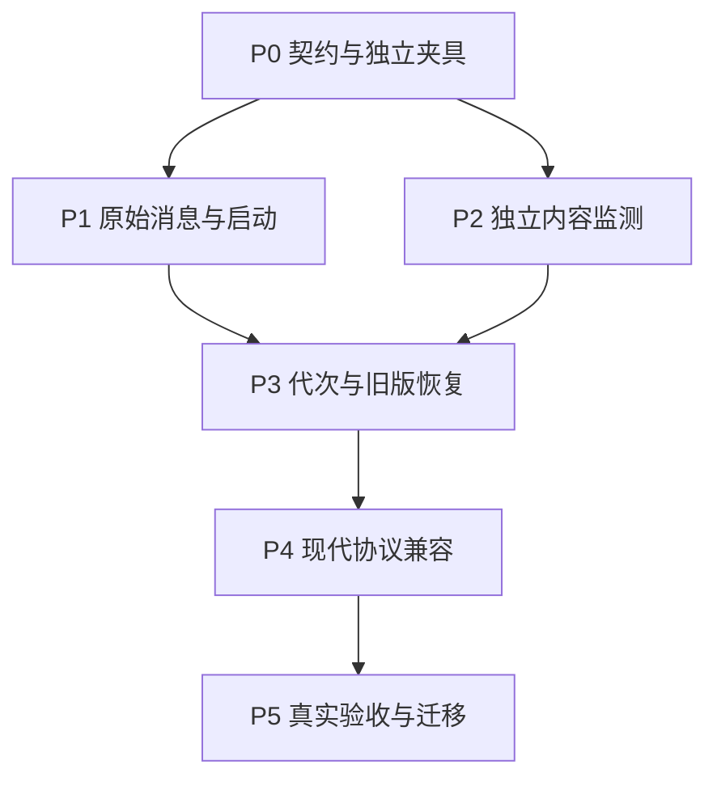

# 实施计划

状态：**已实施**。本文件保留原阶段计划；具体产物、实际运行断言、性能和支持边界见 [实施与验证记录](implementation-results.md)，最终平台门禁以对应代码提交的 CI 为准。需求编号 R01–R12 见 [设计](design.md)，VAL 编号见 [验收计划](validation.md)。

## 1. 阶段与依赖

P1 与 P2 可以并行。P3 由一个集成负责人统一请求账本、失效 epoch、错误和恢复规则；P4 建立在相同的进程及原始消息基础上。P5 的测试框架可提前接入，最终运行结论必须针对集成后的提交。

每个阶段的出门条件都是后续实现的要求。没有运行结果时记 pending；缺少运行平台、fixture 或规范证据时明确记录缺口，不用已有 SDK 测试替代。

验收编号描述完整行为，可能横跨多个阶段。阶段结果必须同时记录 phase、revision 和 assertion_scope：P1 仅要求固定连接/消息组件子断言，P2 仅要求指纹/事件/扫描组件子断言，P3 完成 legacy 集成，P4 完成现代分支，P5 完成真实 gopls 和最终平台矩阵。早期子断言通过不能把整个 VAL 标为 pass，也不能成为依赖后续未实现能力的循环门禁。

## 2. P0：固定契约，建立独立证明手段

| 任务 | 内容与产物 | 依赖 | 出门条件 |
|---|---|---|---|
| TP-P0.1 | 将设计转为内部接口：RawFrame、typed ID、RequestRecord、InputSnapshot、BackendConnectionID、Generation、ProtocolProfile；明确字段所有权 | 本方案 | 路由不含 Tool/CallToolParams 等业务接口；R01–R11 有对应接口位置 |
| TP-P0.2 | 固定 CLI 分隔符、监测 glob/符号链接规则、预算默认值、legacy/modern 错误 code 分配与重连退出行为 | P0.1 | 无 gopls 参数白名单；不会占用所选修订保留错误码；没有留给不同模块自行解释的规则 |
| TP-P0.3 | 新建独立 raw stdio 后端与 raw 客户端；后端启动读一次后永不读输入、不 watch、不自行重载 | P0.1 | VAL-FIX-001/002；同 PID 在输入变化后仍返回旧快照 |
| TP-P0.4 | 固定每个声明支持修订的合法 transcripts；标记 batch、反向交互、ID、取消和订阅差异 | P0.1 | 版本 fixture 与官方修订对应；VAL-MCP-001 的矩阵输入准备齐全 |
| TP-P0.5 | 独立评审契约和夹具 | P0.1–P0.4 | 刷新责任、严格 freshness、业务副作用和 opaque 状态边界无相互冲突承诺 |

夹具既要能证明刷新，也要能注入半帧、阻塞、崩溃、反向请求、MRTR 和订阅。产品不能为测试增加客户端可见的 proxy 专用工具。fixture 的指令只存在于测试 helper。

## 3. P1：通用消息与原生启动接口

| 任务 | 内容与主要文件 | 依赖 | 出门条件 |
|---|---|---|---|
| TP-P1.1 | main.go 采用“proxy flags -- program argv”；原样继承 env/cwd；不通过 shell 拼接 | P0.2 | VAL-CLI-001–004 |
| TP-P1.2 | internal/backend 仅负责子进程、stdio、进程组和 Wait；删除固定后端协议和强制 tools/list 启动前提 | P0.1/P0.3 | VAL-LIFE-001/002 的独立进程路径可测 |
| TP-P1.3 | internal/wire 实现原始帧、完整 JSON 保真、保留类型的 ID、短读短写、大消息 | P0.1/P0.4 | VAL-RAW-001–005 |
| TP-P1.4 | 实现版本允许的 batch 及逐成员账本；队列按请求数与字节计费 | P1.3 | VAL-MCP-004 的固定连接/未派发取消子断言；刷新和 VAL-NOREPLAY-004 在 P3 集成 |
| TP-P1.5 | 建立双向通用消息路由、单向有序写入、关联 ID/token 映射、控制流背压 | P1.2/P1.3 | VAL-ID-001 与 VAL-LIFE-003 的固定连接组件断言；跨连接及现代复用在 P3/P4 |
| TP-P1.6 | 用未知工具/方法、扩展字段和复杂 schema 证明不依赖工具清单；保留原始身份和错误 | P1.5 | 稳定代次 transcript 对照通过，不增加工具前缀或代理工具 |

这一阶段可在固定后端上验证消息通道，不提前宣称已经支持隐藏重启。SDK 能作为测试辅助，但客户端和后端保真 oracle 不能同时依赖同一个强类型 SDK。

## 4. P2：独立内容监测

| 任务 | 内容与主要文件 | 依赖 | 出门条件 |
|---|---|---|---|
| TP-P2.1 | tracker.go 对常规输入流式计算内容指纹，编码路径/类型/存在性/内容/范围 | P0.1/P0.2 | VAL-INPUT-001–005 的指纹子断言；新 PID/前端连接等完整行为在 P3 |
| TP-P2.2 | 通用显式监测范围；Go 工作区发现隔离为可选策略；解析失败保留显式及最后成功范围 | P2.1 | VAL-INPUT-006/011/012 的范围/读取子断言；实际转发在 P3 集成 |
| TP-P2.3 | watcher、轮询及供请求前后使用的扫描 API；dirty epoch 与 fingerprint 分离 | P2.1 | VAL-INPUT-007–010 的事件源/epoch 子断言；派发与交付闸门在 P3 |
| TP-P2.4 | 单工作区扫描合并、上下文取消、范围更新、权限/读取失败和扫描期间变更处理 | P2.2/P2.3 | VAL-INPUT-010/012 的扫描组件子断言；无静默漏项或无限扫描 |
| TP-P2.5 | 替换旧 tracker 内容不变断言，保留依赖存在性、外部目录和 mtime 漏检覆盖 | P2.1–P2.4 | 仅完成旧测试替换表的 tracker 行；supervisor 归 P3，真实 integration 归 P5 |

P2 负责人拥有 workspace 包。main.go 的配置字段先由 P0 定义，通过内部配置对象交接，避免 P1/P2 同时修改入口解析。

## 5. P3：代次、旧协议恢复与一致性

| 任务 | 内容与主要文件 | 依赖 | 出门条件 |
|---|---|---|---|
| TP-P3.1 | supervisor 使用 fingerprint + dirty epoch 控制发布，只有一个活跃后端 | P1/P2 | 完成 legacy 下 VAL-INPUT/GEN 端到端部分；旧 supervisor 断言同步替换 |
| TP-P3.2 | queued/writing/sent/terminal 生命周期；写入前登记归属；部分写入不重放 | P3.1 | VAL-NOREPLAY-001–004 |
| TP-P3.3 | 有界 drain；正反向响应、取消、控制消息保持可推进；阻塞 IO 可以关闭 | P3.1/P1.5 | VAL-CANCEL-001–004、VAL-LIFE-001–004 的 legacy 分支；现代分支在 P4 |
| TP-P3.4 | 真实 legacy 初始化透传；隐藏 bootstrap；能力/初始化信息检查；内部 ID 隔离 | P3.1/P0.4 | VAL-MCP-001–004 的四个 legacy 修订分支、VAL-ID-002 |
| TP-P3.5 | 已支持的旧资源订阅和协议配置恢复；重订后的保守资源失效；无目录通知时完整快照比较；无法恢复时重连 | P3.4 | VAL-STATE-001/005/006/007 和 VAL-MCP-010 的 legacy 分支 |
| TP-P3.6 | 泛化 proxy 错误与严格结果交付校验；上游错误正常保留；已取消请求遵守各版规则 | P3.2/P3.3 | VAL-ERROR-001–004 |
| TP-P3.7 | 删除首工具摘要永久冻结和固定可执行内容拒绝；每次已有启动核对映像和协议约定，不新增即时二进制监听承诺 | P3.4/P3.5 | VAL-GEN-004、VAL-MCP-003/010 |
| TP-P3.8 | 独立并发/恢复审查 | P3.1–P3.7 | 无跨代误关联、无未知状态自动重放、无无限等待 |

P3 的主要集成文件是 internal/proxy。子任务可以编写各自测试或协议模块，但 generation 的发布与请求派发条件必须由同一负责人合并，不能维护两套不一致状态机。

## 6. P4：现代协议与扩展边界

| 任务 | 内容与主要文件 | 依赖 | 出门条件 |
|---|---|---|---|
| TP-P4.1 | 2026-07-28 逐请求版本、capabilities/clientInfo 和标准发现；不强制 initialize/discover | P3/P0.4 | VAL-MCP-005–008 |
| TP-P4.2 | MRTR 原始结果和客户端 continuation；requestState 不透明；每次物理 RPC 独立处理 | P4.1 | VAL-STATE-002/003，无自动发起下一轮 |
| TP-P4.3 | subscriptions/listen 长期状态、ack/filter/subscriptionId、正确结束与重新建立 | P4.1 | VAL-STATE-004；长期订阅不阻塞 drain |
| TP-P4.4 | 现代 ID 合法复用、取消终止和迟到消息隔离 | P4.1/P4.3 | VAL-ID-003/004、VAL-CANCEL-003/004 |
| TP-P4.5 | 未知字段/扩展状态、task/handle 的公开恢复边界；未知 profile 刷新时显式重连 | P4.1–P4.4 | VAL-MCP-009/010、VAL-STATE-005/006 |
| TP-P4.6 | 独立协议评审与五修订兼容矩阵 | P4.1–P4.5 | 正常转发矩阵和恢复矩阵分别有结果，不能合并写一个“兼容通过” |

现代 fixture 的通过只证明该协议配置的 proxy 行为。真实 gopls 是否支持现代协议，以具体可执行文件的实际消息为准；不能把 fixture 能力写到 gopls 身上。

本轮不实现旧式反向请求与现代 MRTR 的跨代翻译，也不虚拟化自动续接现代长期订阅。客户端正确结束后再建立新订阅，是明确的本轮行为。

## 7. P5：真实互通、性能、文档与清理

| 任务 | 内容与主要文件 | 依赖 | 出门条件 |
|---|---|---|---|
| TP-P5.1 | 把无自刷新 raw helper 端到端测试纳入默认 go test；Linux/macOS 均为必跑 | P3/P4 | VAL-CI-001；没有 gopls 环境也不 skip 核心门禁 |
| TP-P5.2 | 修改 real_gopls_test.go，保留连续两次 protobuf 升级，并将内容编辑改为 proxy 重建 | P3/P4 | VAL-GOPLS-001–003 |
| TP-P5.3 | 记录普通调用兼容、内容校验成本、刷新延迟、长期运行资源收敛 | P5.1/P5.2 | VAL-PERF-001/002；不以删内容校验换取通过 |
| TP-P5.4 | 更新 README、docs/design.md、docs/validation.md、CLI/迁移说明；原设计归档状态清楚 | P5.1–P5.3 | 当前行为与已验证版本准确；旧 generation 不变断言已替换 |
| TP-P5.5 | 清除旧工具镜像接口、重复固定版本常量和未使用 SDK 依赖；保留有用进程管理能力 | P3/P4 | 代码不存在两套并行“当前实现”；现有构建/发布自检通过 |
| TP-P5.6 | 对最终提交只读验收 | P5.1–P5.5 | R01–R12 证据齐全，版本/平台/状态恢复缺口明确；达到第 10 节完成条件 |

现有 CI 的 Linux/macOS、最低 Go 版本、race/vet/build、固定 gopls 互通和只读权限保持。此次设计不要求修改 release/tag 发布权限；后续实现若影响二进制构建或 CLI 自检，只调整对应行为验证。

## 8. 必须替换的旧契约

| 原契约 | 新契约 |
|---|---|
| 普通 .go 只哈希路径 | 内容也入指纹；相关写入事件另有失效 epoch |
| 原子保存最终路径不变就不重建 | 内容变化必须重建；已观察写入即使同内容也保守合并重建 |
| roots 由 proxy 声明并提供 | 真实客户端 roots 消息原生通过；监测配置独立 |
| tools-only 前端与 typed CallToolParams 转接 | 通用 envelope/原始正文中继 |
| 首次 ToolDigest/可执行内容必须永久相同 | 通用协议约定与目录更新机制；必要时新前端会话 |
| 刷新中 ping 永远由 proxy 本地成功响应 | 本地 liveness 与原生后端响应的区别在 P0 固定，不伪装后端健康 |
| 旧结果提示直接重试 | 明确派发与响应状态、副作用不确定，不自动重放 |
| 集成只证明 gopls 能看到内容 | 无自刷新后端证明 proxy 因果；真实 gopls 验证互通 |

ping 的默认目标采用原生转发；刷新期间作为已知控制请求按预算处理。若以后提供本地健康检查，必须使用单独的诊断入口并说明含义，不与后端 ping 混淆。

## 9. 子代理协作方式

### 职责分配

| 角色 | 可并行范围 | 文件归属 |
|---|---|---|
| 主代理/集成负责人 | 契约、状态机、跨模块集成、证据和提交 | docs、internal/proxy、最终 CI 集成 |
| 消息与协议实现代理 | P1，随后 P3/P4 中独立协议模块 | internal/wire、internal/protocol、协议 fixtures |
| 监测实现代理 | P2 | internal/workspace、监测 fixtures |
| 独立审查代理 | P0/P3/P4/P5 的只读检查 | 不同时修改被审查模块 |

同一文件同一时段只有一个写入负责人。并行前固定接口，变更接口先与主代理同步；不能各自复制一套错误码、请求账本或恢复逻辑。

默认继承主代理的模型与推理配置；有用户明确要求时遵守其指定，不在子任务中自行降低。执行环境支持的实际模型名称以运行时元数据为准，本方案不写无法验证的模型别名。

### 子任务交付

每个子任务返回任务 ID、基线/产出提交、实际变更文件、运行命令和结果、未覆盖限制、对其他模块的影响。实现代理不能把“写了测试”作为“测试已通过”；协议 fixture 与真实 gopls 结果分别记录。

独立评审者重点检查：已派发请求是否再次发送、dirty epoch 的发布竞态、取消与反向请求是否死锁、长期状态是否被当作可复制业务、生产路径是否仍依赖工具名称。仅审成功样例不够。

主代理统一提交和 PR 状态。子代理不擅自 merge、创建 release/tag、修改仓库权限或扩大实现范围；这不增加用户确认流程，而是保持并行任务的职责边界。

## 10. 完成定义

1. P0–P5 有完成记录，所有声明 supported 的具体修订、平台和恢复行为都有可复核证据。
2. 无自刷新 helper 的负向自证及 proxy 端到端刷新通过；已有 .go 内容变化必须由 proxy 导致后端换代。
3. 所有已派发、部分写入、崩溃与刷新案例无自动重复执行；取消和背压保持有界。
4. 五个修订分别记录结果，未知/不兼容 profile 不伪装恢复；现代 fixture 不替代真实 gopls 证据。
5. 旧测试断言与用户文档完成迁移，支持边界、成本和写工具取舍公开。
6. 最终提交的 Linux/macOS 核心门禁、最低 Go 版本和固定 gopls 互通通过；无 pending 项被写成 pass。

开发期间遇到协议规范差异，应更新对应 profile、规范来源和 fixture。涉及目标契约的改变在方案中记录，不能把无法满足的要求悄悄改成依赖 gopls 自刷新。
