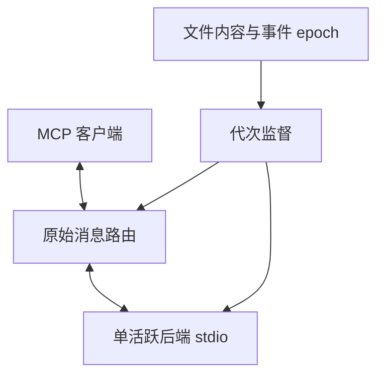

# 当前实现设计

本文描述原始 MCP 中继与代理独立刷新的实现，替代首版“普通 Go 内容编辑交给 gopls”“SDK tools-only 双会话”的设计。原始需求、阶段与完整验收编号保留在[改造方案](changes/proxy-refresh-protocol/README.md)。运行方式见[README](../README.md)，实际验证与缺口见[验证说明](validation.md)。

## 模块边界

| 模块 | 职责 | 不承担的职责 |
|---|---|---|
| `cmd/gopls-mcp-proxy` | 参数边界、cwd/env、信号、stdio 入口 | 解析后端参数或改变 MCP roots |
| `internal/launcher` | 默认 gopls 定位、启动与当前自身身份、候选检查 | 工具业务、项目发现、协议解析 |
| `internal/backend` | 定位程序、原始管道、boot ID、映像摘要、进程组与 Wait | MCP 初始化、工具发现、业务重试 |
| `internal/wire` | 换行帧、原始 JSON、typed ID、精确字段改写 | 工具 schema 或参数解释 |
| `internal/protocol` | 各修订的关联字段、batch、取消、MRTR/订阅形状、代理错误 | 协议跨版本翻译 |
| `internal/workspace` | 通用内容扫描、glob、符号链接边界、事件和可选 Go 发现 | 发送 gopls 命令或依赖 gopls 自刷新 |
| `internal/proxy` | 请求账本、代次发布、背压、失效与状态恢复 | 推测工具副作用或重放业务调用 |

默认通用路径不需要 MCP SDK，也不需要运行 `go env`。Go 依赖解析仅在显式 `--go-discovery` 下启用。

## 默认启动入口

无参数或仅合法代理选项选择 `gopls mcp`；显式 `-- program argv` 保持通用解析。CLI 先处理 help/version 和参数错误，再捕获 cwd/env、自身物理路径及文件身份。默认 resolver 只查物理目录 sibling 和绝对 PATH 项：首个 Lstat 存在的候选绑定，坏链接/不可执行/自身别名明确失败。定位或初始身份检查失败在 tracker 创建之前返回。

`backend.Config.BeforeStart` 由生产 CLI 在两种模式中注入，逐次执行前重新检查固定 locator。它同时比较代理启动时 inode 和当前自身路径的身份；检查失败消耗 boot attempt，关闭新管道，不发布新进程。通用 backend 测试可注入独立身份，不存在生产环境变量绕过检查的入口。

定位路径保留后端 symlink，以允许原路径升级；后续损坏不触发重新发现。默认值、监测范围、Go discovery 和协议策略未变。完整契约见[默认入口设计](changes/default-gopls-launcher/design.md)，分层运行结果见[实施结果](changes/default-gopls-launcher/implementation-results.md)。

## 输入检查点

默认纳入 cwd 和显式 watch roots 内所有常规输入文件，完整内容采用流式 SHA-256。指纹还编码范围、相对路径、文件类型、存在性和符号链接目标；不会用 mtime 或仅文件路径替代内容。

事件失效 epoch 与指纹分离。已观察到相关写入或替换，即使文件最终恢复原内容，也会使旧后端失效。单纯元数据事件安排内容复核，不独自构成内容失效。监听缺失时，周期扫描、派发前扫描和交付前扫描仍可发现最终内容变化。

并发扫描通过单工作区扫描门合并；扫描期间内容或 epoch 改变会有限重试。读取失败不能悄悄跳过必需输入。显式范围在可选 Go 解析失败时仍保留，最后成功发现的范围也继续监测。

内部符号链接只哈希目标文本、不递归跟随；显式根的符号链接每次扫描重新解析。默认仅排除版本控制内部目录。监测根不是客户端 roots 的来源。

检查点不构成文件系统事务。两次观察之间且没有事件可用的短暂变动无法证明发现。每次内容校验会消耗磁盘读取和 CPU，范围与性能应一起评估。

## 原始中继与账本

stdio 使用 UTF-8 JSON 和换行分帧。读取支持短读和跨缓冲大帧；写入串行处理短写。帧、排队请求、排队字节和控制输出均有预算，超限或持续背压显式结束受影响连接。

消息保留原始正文，允许未知方法与扩展字段通过。ID 不经过 float64，数字 `1` 与字符串 `"1"` 区分；双向同名 ID 按方向和物理连接区分。必要时精确改写 ID、进度或订阅关联字段，其余业务字段不重建为强类型对象。

每个请求绑定接收期限、boot ID 和 generation。进入写入前先登记派发归属；部分写入视为可能已派发。请求取消、超时或崩溃后不会自动重放原业务。未发送队列可在新代次首次派发。对迟到消息和有歧义的 ID 复用进行连接隔离；内部恢复请求使用独立关联，不向客户端泄漏内部响应。

batch 仅在 `2025-03-26` profile 允许，按成员登记并计费。一次 batch 整体 admission、整体派发，不拆分执行；请求成员数不得超过 max-concurrent，队列数量、字节和帧也必须同时满足预算。超限在写入前拒绝；混有通知时因无法向通知返回错误而结束连接。通知没有请求 ID，不能伪造错误响应。`ping` 原生转发，不作为代理本地健康检查。

## 代次与进程生命周期

1. 内容差异或已确认写入事件立即使旧代次失效，记录不可被后续事件重置的刷新起点。
2. 暂停新普通请求；有界排空已派发有限请求。反向交互回复、取消等必要控制消息继续推进。
3. 结束需要跨进程终止的长期订阅；它们不占用有限请求 drain 计数。
4. 回收旧进程和其 Unix 进程组，顺序为 stdin EOF、TERM、KILL、Wait。关闭管道同时解除阻塞读写。
5. 仅确认清理成功后，启动具有新 boot ID 的候选。失败尝试也消耗独立身份。
6. 执行允许的协议恢复，复核输入指纹与 epoch，再发布 generation。启动过程中失效的候选被回收。

启动环境、argv 和绝对程序定位路径在代理生命周期内固定；定位路径的符号链接目标不固定。每次 spawn 记录映像 SHA-256，变化可以被接受，是否能维持客户端连接还需协议检查。摘要只是观测信息，hash 与 exec 不是原子操作，不作为映像安全证明。

不能确认 Wait 或进程组清理完成时，Factory 拒绝后续启动。刷新预算耗尽仍必须执行独立的最后清理，不假报回收成功。

## 恢复与重新连接

稳定代次中的通用转发与跨代恢复是两项不同承诺。恢复代码只持有已确认交付的协议状态，不保存业务调用作为重放队列。

| 状态 | 当前策略 |
|---|---|
| 四个 legacy profile 的标准 initialize / initialized | 真实首次握手透传；候选使用已协商版本重建；比较完整可观察初始化约定 |
| 标准日志级别 | 仅恢复成功确认且无未知扩展的设置 |
| legacy 资源订阅 | 恢复确认订阅，再发送保守资源失效通知 |
| tools/resources/resource templates/prompts 目录 | 合法 listChanged 通知，或完整分页快照比较；不全、变化或不可比较则重连 |
| 客户端 roots、sampling、elicitation | 正常双向路由，由真实客户端响应；代理不替代客户端身份 |
| 现代逐请求 metadata | 每次保留原始版本、能力、身份；不继承上一请求默认值 |
| 现代 MRTR | 原样转发 input_required 和客户端 continuation；不自动发起下一轮 |
| 现代 subscriptions/listen | 跟踪 acknowledged/终止；进程边界结束旧订阅，客户端自行重新建立 |
| task、未知 handle、cursor、requestState | 正常消息保真；不承诺跨进程迁移或业务状态恢复 |
| 未知 profile、未知初始化状态扩展 | 正常透传范围内保留；缺少恢复规则时要求重新连接 |

首次连接不强制列举工具。目录快照主要来自实际已交付的客户端枚举；刷新需要比较时从起点重新遍历候选目录，不复用旧 cursor。完整性包括未知字段、描述、schema、annotations、分页结束及重复 cursor 检查，不只比较工具名称。

初始化版本、能力、身份、instructions 等约定变化或恢复条件不满足时，`protocol_restart_required` 终止前端 stdio。客户端需重新连接；不能假设客户端一定自动重启。现代 fixture 只证明代理对该形状的处理，不代表真实 gopls 具有相同协议能力。

## 错误、预算和观测

代理错误采用 JSON-RPC 应用 code `1000`，避免使用 JSON-RPC 及 MCP 保留区间。`data` 记录来源、原因、generation、是否可能派发、是否收到后端响应、副作用是否未知以及禁止自动重放。后端错误保持原样，不变成代理成功或工具 `isError`。

合法写工具可能已产生效果，随后因为输入变化而被拒绝交付旧结果。严格结果检查不等于副作用回滚。

默认预算见 README：请求总期限 110s，正常刷新 60s，最后清理 6s，启动 45s，排空 5s，EOF/TERM 各 2s。阶段上限受剩余总预算约束。现代订阅建立后不应用普通有限请求期限，MRTR 每个物理 RPC 独立计时。

日志写 stderr，包含刷新原因、输入范围/指纹/epoch、generation、boot ID、PID、映像摘要和故障阶段。生产路径不记录完整业务报文或环境；完整 transcript 仅用于不含业务秘密的受控测试。
