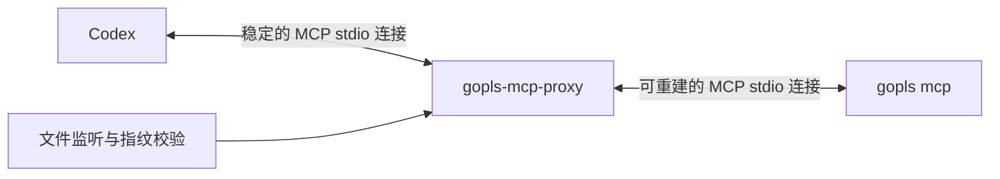

# gopls MCP 按工作区变化重建后端的技术方案

本文描述拟实现的 `gopls-mcp-proxy`。代理保持与 Codex 的 MCP 连接，检测到依赖文件或 Go 文件结构变化后，重建内部 gopls 进程。本文为设计文档，所示代理命令行参数尚待实现。



代理使用 Go 和 MCP Go SDK 实现，分为四个模块：

| 模块 | 职责 |
|---|---|
| MCP Frontend | 接收 Codex 请求，提供工具清单，保持连接 |
| WorkspaceTracker | 检测依赖文件变化和 Go 文件集合变化 |
| BackendSupervisor | 启动、初始化、关闭和重建 gopls |
| RequestRouter | 控制请求排队、转发、取消和结果返回 |

## 1. 变更检测规则

| 变化 | 是否重建 |
|---|---|
| `go.mod`、`go.sum`、`go.work` 内容变化、新增或删除 | 是 |
| `go.work.sum` 变化 | 是，一并覆盖工作区依赖状态 |
| `.go` 文件新增、删除或重命名 | 是 |
| 已有 `.go` 文件仅修改内容 | 否，继续由 gopls 的文件监听处理 |
| 文件时间戳变化，内容和文件集合未变 | 否 |
| 编辑器原子保存，删除后重建同路径 `.go` 文件 | 合并事件后判断，最终路径集合未变则不重建 |

检测范围以配置的 workspace 为基础，同时纳入实际生效的 `go.work`、工作区模块，以及明确配置的本地 `replace` 目录。避免扫描整个用户目录或整个 Go module cache。

同时使用事件监听与指纹校验：

- `fsnotify` 负责快速发现变化，事件先标记“需要核对”。
- 后台每 2 秒扫描一次，弥补漏事件、目录移动和监听失败。
- 每次工具请求派发前再次核对指纹，避免在后台扫描间隔内使用旧进程。

指纹由两部分组成：

```text
dependencyDigest = SHA256(依赖文件路径、存在状态、内容)
goFileSetDigest = SHA256(排序后的全部 .go 文件路径)
workspaceFingerprint = SHA256(dependencyDigest + goFileSetDigest)
```

编码时使用确定性的排序和字段边界，确保相同工作区生成相同指纹。普通 `.go` 文件不计算内容哈希。依赖文件不能只比较 mtime，否则相同时间戳或原子替换可能漏检。

## 2. 重建流程

采用单个重建任务、暂停派发、完成后恢复的方式，先保证正确性和实现简单。

1. 监听到事件后设置待核对标记，暂停新的工具请求派发。
2. 等待 500ms 安静窗口，合并 `go get`、代码生成、分支切换产生的连续事件。
3. 计算最终指纹；没有实际变化则恢复派发。
4. 指纹变化时，将当前后端标记为失效，进入重建流程。
5. 等待已有请求结束，最长等待一个可配置的排空时间。
6. 关闭旧后端，启动新的 `gopls mcp`。
7. 完成 MCP 初始化、roots 配置和工具清单获取。
8. 再次计算指纹；启动期间发生变化则放弃该后端，重新等待稳定。
9. 指纹稳定且初始化成功后，发布新的后端代次，恢复排队请求。

每次成功重建增加 `generation`。状态结构示意如下，其中 `Fingerprint` 和 `BackendSession` 为代理内部类型：

```go
type BackendState struct {
    Generation  uint64
    Fingerprint Fingerprint
    Session     *BackendSession
}
```

后台只有一个 supervisor 能改变后端状态，避免多个并发工具调用同时启动多个 gopls。

持续发生变化时，不能无限延长单次请求。超过请求等待预算后返回明确的“工作区仍在变化，请重试”，等文件稳定后再恢复。

## 3. 请求一致性与并发处理

每个请求绑定派发时的 `generation` 和指纹。

| 情况 | 处理方式 |
|---|---|
| 后端就绪且指纹一致 | 正常派发 |
| 正在核对或重建 | 请求进入有界队列 |
| 请求排队期间被取消 | 从队列移除 |
| 请求执行期间检测到结构变化 | 标记结果可能过期 |
| 返回结果前确认指纹已变化 | 返回过期错误，不交付旧分析结果 |
| 后端意外退出 | 当前请求失败，后续请求等待重建 |
| 后端重建失败 | 返回错误，不继续使用已失效的旧后端 |

已经发送给后端的请求不自动重放。即使当前多数 gopls 工具只读，也应避免把代理设计成默认重试任意工具调用。尚未派发的排队请求可以在新后端执行。

一致性保证以派发前和返回前的校验时刻为界；该方案不提供文件系统事务快照。

## 4. MCP 连接与协议处理

代理分别终止上下游 MCP 会话，而不是简单转发字节流。

- Codex 只初始化代理一次。
- 每次重建 gopls，代理都重新完成下游 `initialize` → `notifications/initialized`。
- 使用 SDK 管理两侧请求 ID，取消、进度通知需要映射到对应请求和后端代次。
- 原样保留工具的输入输出 schema、annotations、`content`、`structuredContent` 和 `isError`。
- 代理提供自己的 `ping`，重建期间仍可响应。
- 只声明代理实际实现的能力。

每个新后端都必须重新执行初始化和能力协商，不能沿用上一个进程的会话状态。参见 [MCP 生命周期](https://modelcontextprotocol.io/specification/2025-11-25/basic/lifecycle)。

代理主动向 gopls 提供 roots。下游初始化时声明 roots 能力，收到 `roots/list` 后返回配置的工作区目录。这样 gopls 的文件监听不再依赖 Codex 是否提供 roots。参见 [MCP roots](https://modelcontextprotocol.io/specification/2025-11-25/client/roots)。

初版固定同一个 gopls 可执行文件及工具清单。重建后若工具 schema 发生变化，应要求重建代理会话，避免 Codex 持有的工具定义与后端不一致。

## 5. 进程与异常管理

旧后端按以下顺序退出：

```text
关闭 stdin → 等待退出 → SIGTERM → 超时后 SIGKILL
```

这一顺序符合 MCP 对 stdio 服务的关闭建议。每个子进程都必须 `Wait` 回收；代理退出时也要清理后端。参见 [MCP 生命周期](https://modelcontextprotocol.io/specification/2025-11-25/basic/lifecycle)。

其他处理规则：

- 后端启动失败采用有上限的指数退避，避免反复拉起。
- `go.mod` 暂时处于无效状态时，返回真实加载错误；文件修复后重新检测。
- 监听失败或事件溢出时，立即安排全量核对，继续保留轮询兜底。
- 后端启动前后都校验指纹，防止启动过程中加载到变化中的依赖。
- 代理和 gopls 日志写入 stderr；stdout 仅用于 MCP 消息。参见 [MCP stdio](https://modelcontextprotocol.io/specification/2025-11-25/basic/transports)。

日志至少包含 `generation`、重建原因、指纹摘要、耗时、排队数和失败阶段，便于区分“检测到了但没重建”与“重建了但加载失败”。

## 6. Codex 接入配置

以下命令行参数属于拟实现的代理接口：

```toml
[mcp_servers.gopls]
command = "/Users/zhujiawei/.local/bin/gopls-mcp-proxy"
args = [
  "--gopls", "/Users/zhujiawei/go/bin/gopls",
  "--workspace", "/Users/zhujiawei/GolandProjects/game-plugin",
  "--debounce", "500ms",
  "--poll-interval", "2s"
]
cwd = "/Users/zhujiawei/GolandProjects/game-plugin"
startup_timeout_sec = 60
tool_timeout_sec = 120
```

沿用现有 `GOROOT`、`PATH` 等环境配置。代理内部的排队、重建和执行时间应共享一个请求总期限，避免超过 Codex 的工具超时。上述 Codex 配置项均为已支持选项，参见 [官方配置参考](https://learn.chatgpt.com/docs/config-file/config-reference)。

## 7. 验收标准

| 场景 | 预期 |
|---|---|
| 同一代理会话内升级 protobuf | 后端 generation 增加，符号路径指向新依赖 |
| 新增、删除、重命名 Go 文件 | 自动重建，工具结果反映新文件集合 |
| 仅修改已有 Go 文件内容 | 不重建，gopls 正常更新分析 |
| 原子保存已有文件 | 不因短暂删除事件产生无效重建 |
| 一次生成数百个 Go 文件 | 事件合并，在稳定后重建 |
| 模拟丢失全部监听事件 | 请求前校验或轮询仍能发现变化 |
| 长请求期间修改 go.mod | 旧结果被识别为过期，新请求使用新后端 |
| 重建过程中再次修改依赖 | 不发布与当前指纹不一致的后端 |
| gopls 崩溃、超时、加载失败 | 请求明确失败，后续可恢复，无孤儿进程 |

首版实现单工作区、单后端、双 MCP 会话、指纹检测和串行重建。最关键的验收是：Codex 与代理的连接始终不变，连续升级两次 protobuf，均能自动切换到对应的新依赖。
